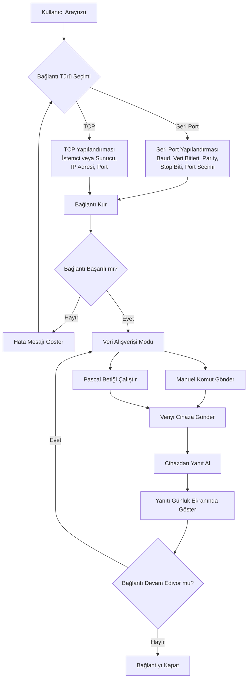
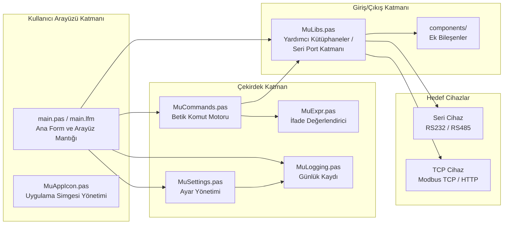
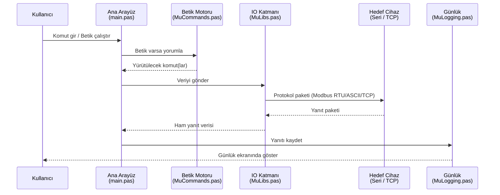

# MuTerm

**MuTerm**, Modbus RTU, Modbus ASCII, IEC 62056-21 gibi endüstriyel cihazlarla **seri port (RS232 / RS485)** veya **TCP soket** bağlantısı üzerinden haberleşmek için geliştirilmiş, Windows ve Linux üzerinde çalışabilen bir terminal yazılımıdır. Proje, **Lazarus / Free Pascal** ile geliştirilmiştir ve esnek bir **Pascal betik motoru** sunar. Gerçek donanım olmadan test için Python tabanlı cihaz simülatörleri de içerir.

> ⚠️ **Lisans Notu:** Proje yazarı **Mehmet Ulukaya**, tüm haklarının saklı olduğunu ve yazılımın **ticari ürünlerde kullanılmaması** gerektiğini açıkça belirtmiştir. Yazılımı kendi projelerinizde kullanacaksanız kendi çözümünüzü geliştirmeniz önerilir.

---

## İçindekiler

1. [Özellikler](#özellikler)
2. [Çalışma Prensibi](#çalışma-prensibi)
3. [Mimari ve Bileşenler](#mimari-ve-bileşenler)
4. [Proje Yapısı](#proje-yapısı)
5. [Veri Akışı](#veri-akışı)
6. [Kurulum ve Derleme](#kurulum-ve-derleme)
7. [Kullanım Senaryoları](#kullanım-senaryoları)
8. [Betik Motoru](#betik-motoru)
9. [Simülatörler ve Yardımcı Araçlar](#simülatörler-ve-yardımcı-araçlar)
10. [Platform Desteği ve Sınırlamalar](#platform-desteği-ve-sınırlamalar)
11. [Katkıda Bulunma](#katkıda-bulunma)
12. [Kaynaklar](#kaynaklar)

---

## Özellikler

### Bağlantı Katmanı
- **Seri Port İletişimi:** RS232, RS485 arayüzleri üzerinden Modbus RTU ve ASCII protokolleriyle haberleşme. Baud rate, veri biti, parity ve stop biti gibi parametreler yapılandırılabilir.
- **TCP Soket Desteği:** Hem **TCP istemci** hem de **TCP sunucu** modlarında çalışabilir. Yerel ağ veya internet üzerinden Modbus TCP / HTTP gibi protokollerle haberleşme sağlar.

### Betik ve Komut Desteği
- **Pascal Betik Motoru:** Cihazlarla özel iletişim rutinleri (döngüsel sorgulama, otomatik yanıt, veri dönüştürme vb.) yazmak için Pascal tabanlı betik desteği.
- **`Send` Alanı Komut Dili:** `:COMM_SETUP`, `:SEND_TEXT`, `:COM_RECV_TEXT`, `:WAIT` gibi hazır komutlar; değişkenler (`{isim}`), etiketler, `:GOTO`, `:IF` / `:ELSE` blokları ve ifade işlevleri (`POS`, `CONTAINS`, `LEN`, `TRIM` ...). Ayrıntılar: [`docs/script-commands.md`](docs/script-commands.md).
- **Zaman Aşımı Yönetimi:** `:COM_RECV_TEXT`, `:COM_WAIT_FOR_TEXT` gibi komutlar `TIMEOUT` değişkenini günceller; betikler koşullu olarak hata yoluna ayrılabilir.
- **Komut Editörü:** Betik yazarken `CTRL+Space` kısayolu ile **komut tamamlama / öneri listesi** sunar.

### Arayüz ve Günlükleme
- **Özelleştirilebilir Günlük Ekranı:** ASCII günlük ekranı için TrueType yazı tipi değiştirilebilir; okunabilirlik artırılabilir.
- **Ayar Yönetimi:** Bağlantı parametreleri ve betik ayarları kalıcı olarak saklanır.

### Platform Desteği
- **Windows** ve **Linux** (Debian tabanlı Mint 32-bit üzerinde test edilmiştir).
- **Taşınabilir (portable)** kullanım hedeflenmiştir.

---

## Çalışma Prensibi

MuTerm'in temel akışı şu adımlardan oluşur:

1. Kullanıcı bir **bağlantı türü** seçer: **Seri Port** veya **TCP Soket**.
2. Seçilen bağlantı türü için **parametreler** yapılandırılır (port adı, baud rate, IP, port numarası vb.).
3. Bağlantı kurulur; başarısız olursa hata mesajı gösterilir ve kullanıcı yeniden yapılandırmaya yönlendirilir.
4. Bağlantı kurulduktan sonra kullanıcı iki moddan birini kullanabilir:
   - **Manuel Komut Gönderimi:** Arayüz üzerinden elle komut yazıp gönderme.
   - **Pascal Betiği Çalıştırma:** Önceden yazılmış bir betik ile otomatik sorgulama / yanıt döngüsü.
5. Gönderilen veri cihaza iletilir, cihazdan gelen yanıt alınır ve **günlük ekranında** görüntülenir.
6. Bağlantı devam ettiği sürece bu döngü sürer; kullanıcı bağlantıyı kapattığında oturum sonlanır.

Aşağıdaki Mermaid diyagramı bu akışı özetler:



---

## Mimari ve Bileşenler

MuTerm, sorumlulukların ayrıştırıldığı modüler bir yapıya sahiptir. Her birim (unit) belirli bir görevi üstlenir:



| Bileşen | Sorumluluk |
|---|---|
| `main.pas` / `main.lfm` | Ana form, kullanıcı etkileşimleri, bağlantı yönetimi |
| `MuCommands.pas` | Betik komut motoru; `:KOMUT(...)` satırlarının yorumlanması ve çalıştırılması |
| `MuExpr.pas` | Koşul ve ifade değerlendirici; `POS`, `CONTAINS`, `LEN`, karşılaştırmalar |
| `MuSettings.pas` | Bağlantı ve uygulama ayarlarının saklanması / yüklenmesi |
| `MuLogging.pas` | Günlük kaydı; ASCII günlük ekranı ve dosya kaydı |
| `MuLibs.pas` | Seri port ve soket işlemleri için yardımcı kütüphaneler |
| `MuAppIcon.pas` | Uygulama simgesi yönetimi (özellikle GTK2 üzerinde alfa kanalı koruma) |
| `components/` | Ek bileşenler |
| `tools/` | Yardımcı araçlar |

---

## Proje Yapısı

Depo kök dizininde yer alan dosya ve klasörler:

| Dosya / Klasör | Açıklama |
|---|---|
| `MUTerm.lpi` | Lazarus proje dosyası (derleme yapılandırması, hedefler) |
| `MUTerm.lpr` | Ana program dosyası (giriş noktası) |
| `MUTerm.lps` | Lazarus oturum dosyası |
| `MUTerm.ico` / `MUTerm.png` | Uygulama simgeleri |
| `MUTerm.res` | Derlenmiş kaynak dosyası (simge ve meta veriler) |
| `main.pas` / `main.lfm` | Ana form kodu ve form tanımı |
| `MuCommands.pas` | Betik komut motoru |
| `MuExpr.pas` | Betik ifade değerlendirici |
| `MuSettings.pas` | Ayar yönetimi |
| `MuLogging.pas` | Günlük kaydı işlemleri |
| `MuLibs.pas` | Yardımcı kütüphaneler / seri port katmanı |
| `MuAppIcon.pas` | Simge yönetimi |
| `components/` | Ek bileşenler |
| `docs/` | Belgelendirme (betik komutları vb.) |
| `tools/` | Simülatörler ve yardımcı betikler (ayrıntılar: `tools/README.md`) |
| `tools/mu_sim.py` | Modbus RTU köle cihaz simülatörü |
| `tools/mu_counter.py` | IEC 62056-21 elektrik sayacı simülatörü |
| `binaryfiles/` | Derlenmiş ikili dosyalar |
| `backup/` | Yedek dosyalar (eski sürümler) |
| `.github/workflows/` | GitHub Actions CI iş akışları |
| `.gitignore` | Sürüm kontrolü dışında tutulan dosyalar |

---

## Veri Akışı

Aşağıdaki diyagram, bir komutun kullanıcıdan cihaza ve geri dönüş yolculuğunu gösterir:



---

## Kurulum ve Derleme

### Gereksinimler
- **Lazarus IDE** (proje tarihsel olarak Lazarus 1.0 – 1.6 aralığında geliştirilmiştir)
- **Free Pascal Compiler (FPC)**
- İşletim sistemi: Windows veya Linux (Debian tabanlı dağıtımlar test edilmiştir)

### Derleme Adımları

1. Lazarus IDE'yi sisteminize kurun.
2. Depoyu klonlayın:
   ```bash
   git clone https://github.com/mehmetulukaya/muterm.git
   cd muterm
   ```
3. `MUTerm.lpi` proje dosyasını Lazarus IDE ile açın.
4. Hedef platformu seçin:
   - **Windows:** Varsayılan hedef.
   - **Linux:** Proje ayarlarından hedef işletim sistemini Linux olarak değiştirin.
5. **Build** veya **Run** komutunu çalıştırın.
6. Derleme çıktısı `binaryfiles/` klasöründe veya proje kökünde oluşacaktır.

### CI / Otomatik Derleme
Projede GitHub Actions iş akışları bulunmaktadır (`.github/workflows/`). Bu iş akışları, Lazarus derleme günlüğünü yakalayıp hataları raporlar. Önceden AppVeyor ve Travis CI kullanılıyordu; şu anda GitHub Actions'a geçiş yapılmıştır.

---

## Kullanım Senaryoları

### Senaryo 1: Seri Port ile Modbus RTU Cihazına Bağlanma
1. Uygulamayı başlatın.
2. Bağlantı türü olarak **Seri Port** seçin.
3. Port adını (ör. `COM3` veya `/dev/ttyUSB0`), baud rate'i (ör. `9600`), veri bitini, parity'yi ve stop bitini ayarlayın.
4. **Bağlan** düğmesine tıklayın.
5. Manuel komut alanına Modbus sorgu çerçevesini girin veya hazır bir betik yükleyin.
6. Yanıtları günlük ekranında izleyin.

### Senaryo 2: TCP Soket ile Modbus TCP Cihazına Bağlanma
1. Bağlantı türü olarak **TCP** seçin.
2. **İstemci** modunu seçin; hedef IP adresini ve portu (varsayılan Modbus TCP portu `502`) girin.
3. **Bağlan** düğmesine tıklayın.
4. Manuel komut veya betik ile sorgulama yapın.
5. Gelen yanıtları günlük ekranında görüntüleyin.

### Senaryo 3: Otomatik Sorgulama Betiği
1. Komut editörünü açın.
2. `CTRL+Space` ile komut önerilerinden yararlanarak bir Pascal betiği yazın (ör. belirli aralıklarla register okuma).
3. Betiği çalıştırın; MuTerm sorguları otomatik olarak gönderir ve yanıtları günlüğe kaydeder.

### Senaryo 4: Donanım Olmadan Simülatörle Test
1. Bir terminalde Modbus veya IEC 62056-21 simülatörünü başlatın:
   ```bash
   ./tools/mu_sim.py --pty --pty-link /tmp/muterm-pty
   # veya
   ./tools/mu_counter.py --pty --pty-link /tmp/muterm-counter
   ```
2. Çıktıda bildirilen `/tmp/...` yolunu MuTerm'de port olarak seçin.
3. Hazır betiği (`tools/modbus_demo.scp`) veya `docs/script-commands.md` içindeki el sıkışma betiğini çalıştırın.
4. Yanıtları günlük ekranında izleyin; `--hex` ve `--debug` ile ham çerçeveleri inceleyin.

---

## Betik Motoru

`MuCommands.pas` içinde yer alan betik motoru, cihazlarla özel iletişim rutinleri yazmayı sağlar. `Send` alanındaki `:KOMUT(...)` satır dili; değişkenleri, etiketleri, `:GOTO` atlamalarını, tek satırlık ve blok `:IF` / `:ELSE` yapılarını destekler. Koşullar `MuExpr.pas` tarafından değerlendirilir; `POS`, `POSP`, `CONTAINS`, `LEN`, `TRIM`, `UPPER`, `LOWER` gibi işlevler ve `TIMEOUT` değişkeni kullanılabilir.

```text
:SET(isim,Ahmet)
:SET(mesaj,MERHABA {isim}!#013#010)
:SEND_TEXT({mesaj})

:LABEL BASLA
:COM_RECV_TEXT(cevap,1.0)
:IF(TIMEOUT = 1) GOTO HATA
:WAIT 1.0
:GOTO BASLA

:LABEL HATA
:SEND_TEXT(Zaman asimi#013#010)
:END
```

Tipik kullanım alanları:

- Belirli aralıklarla otomatik sorgulama (polling)
- Gelen verilere göre koşullu yanıt üretme
- Veri dönüştürme ve biçimlendirme
- Çok adımlı protokol sekansları (el sıkışma, kimlik doğrulama vb.)

Komutların tam listesi ve ifade dili için [`docs/script-commands.md`](docs/script-commands.md) dosyasına bakın. Komut editörü ayrıca yazım sırasında `CTRL+Space` ile **otomatik tamamlama** sunar.

---

## Simülatörler ve Yardımcı Araçlar

`tools/` dizini, MuTerm'i gerçek donanım olmadan denemek için Python tabanlı simülatörler ve kurulum betikleri içerir. Ayrıntılı kullanım ve tüm seçenekler: [`tools/README.md`](tools/README.md).

| Araç | Açıklama |
|---|---|
| `tools/mu_sim.py` | Modbus RTU köle cihazı (FC3/FC4/FC6/FC16); PTY veya gerçek seri port |
| `tools/mu_counter.py` | IEC 62056-21 (Mod C) elektrik sayacı; 300 7E1 sign-on, 9600 7E1 veri okuma |
| `tools/modbus_demo.scp` | Modbus okuma/yazma/geri okuma örnek betiği |
| `tools/setup_tty0tty.sh` | tty0tty sanal null-modem sürücüsünü kurar / kaldırır |
| `tools/install_desktop.sh` | Masaüstü girişi ve uygulama ikonu kurar |

Her iki simülatör de root gerektirmeyen bir PTY ile başlatılabilir:

```bash
./tools/mu_sim.py --pty --pty-link /tmp/muterm-pty
./tools/mu_counter.py --pty --pty-link /tmp/muterm-counter
```

Çıktıda bildirilen yolu MuTerm'de port olarak açın. `mu_counter.py`, seri port yardımcılarını `mu_sim.py`'den aldığı için iki dosya aynı dizinde kalmalıdır. RTS/DTR/CTS/DSR gibi modem hatlarını denemek için PTY yerine tty0tty veya gerçek bir UART kullanın.

---

## Platform Desteği ve Sınırlamalar

| Konu | Durum |
|---|---|
| Windows | ✅ Destekleniyor |
| Linux (Debian tabanlı) | ✅ Test edilmiş (Mint 32-bit) |
| Modbus RTU / ASCII | ✅ Seri port üzerinden |
| Modbus TCP / HTTP | ✅ TCP soket üzerinden |
| IEC 62056-21 | ✅ `tools/mu_counter.py` simülatörü ile test edilebilir |
| Betik motoru (`Send` dili) | ✅ Değişkenler, etiketler ve `:IF` blokları dahil |
| Python simülatörler | ✅ Python 3 (harici paket gerekmez) |
| Ticari kullanım | ❌ Yazar tarafından yasaklanmıştır |
| 64-bit Linux | ⚠️ Test edilmemiş (32-bit üzerinde test edilmiştir) |

---

## Katkıda Bulunma

Proje kişisel bir proje olup yazarın tüm hakları saklıdır. Ticari kullanım için lütfen yazarla iletişime geçin. Katkı sağlamak isterseniz:

1. Depoyu forklayın.
2. Yeni bir dal (branch) oluşturun: `git checkout -b ozellik/yeni-ozellik`
3. Değişikliklerinizi commit edin: `git commit -m "feat: yeni özellik eklendi"`
4. Dalınızı push edin: `git push origin ozellik/yeni-ozellik`
5. Pull request açın.

---

## Kaynaklar

- **GitHub Deposu:** [mehmetulukaya/muterm](https://github.com/mehmetulukaya/muterm)
- **Free Pascal Wiki — Lazarus Communications Software:** MUTerm
- **Lazarus IDE:** [https://www.lazarus-ide.org/](https://www.lazarus-ide.org/)
- **Free Pascal:** [https://www.freepascal.org/](https://www.freepascal.org/)

---

> **Son Not:** Bu README, depodaki dosya yapısı, commit geçmişi ve proje açıklaması temel alınarak hazırlanmıştır. Proje hakkında daha fazla bilgi için yukarıdaki GitHub bağlantısını ziyaret edebilirsiniz.
